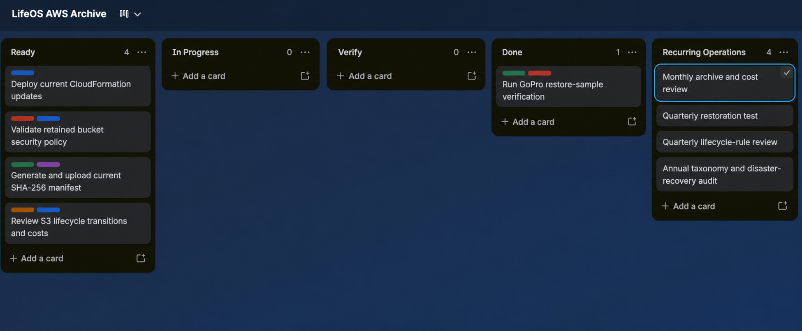

# Project Management Case Study

LifeOS AWS Archive is managed as an operational infrastructure project rather
than a one-time file transfer. The project board connects implementation work
with explicit verification, documentation, and recurring archive maintenance.

_Workflow snapshot captured during pilot validation; the manifest and photo
pilot cards were subsequently moved to Done._

The screenshot is redacted to remove account navigation and profile details.
Raw Trello JSON exports are kept out of the repository because they may contain
account identifiers, activity history, internal URLs, and invitation details.

## Workflow

| List | Purpose | Exit condition |
| --- | --- | --- |
| Inbox | Capture untriaged work without interrupting active execution. | The card is clarified, labeled, and moved to Backlog or Ready. |
| Backlog | Hold valuable work that is not yet scheduled. | Scope and prerequisites are understood. |
| Ready | Queue tasks that can begin without further discovery. | Capacity is available and dependencies are satisfied. |
| In Progress | Show the single primary task currently being executed. | Implementation is complete and evidence is ready for review. |
| Verify | Hold work awaiting dry-run, checksum, restore, security, or cost validation. | Acceptance checks pass or the card returns to In Progress. |
| Done | Preserve completed work and its verification evidence. | No required work remains. |
| Recurring Operations | Track periodic cost, lifecycle, restoration, and recovery reviews. | The review is recorded and its next occurrence is scheduled. |

Work-in-progress is intentionally limited. Archive batches move through
`In Progress` and `Verify` individually so a successful upload cannot be
mistaken for a verified backup.

## Labels

| Label | Scope |
| --- | --- |
| Infrastructure | CloudFormation, S3 configuration, deployment, and policy work |
| Security | Encryption, public-access controls, transport policy, and recovery validation |
| Automation | Repeatable scripts, guarded uploads, and operational tooling |
| Operations | Archive execution, verification, restoration, and maintenance |
| Cost | AWS Budgets, storage-class transitions, and cost reviews |
| Documentation | Runbooks, architectural decisions, and portfolio material |

Labels describe the nature of the work; list position describes its current
state. Cards may carry more than one label when responsibilities overlap.

## Verified Milestones

### GoPro archive

- Uploaded and reconciled 63 files totaling approximately 178 GiB.
- Confirmed that the final synchronization dry run had no remaining uploads.
- Restored a video sample from S3 and matched its SHA-256 digest to the local
  original.
- Played the restored media and compared it with the source file.
- Generated and uploaded portable file-list and SHA-256 manifests.

### Photo archive pilot

- Exported original media with XMP metadata sidecars from Apple Photos.
- Uploaded and reconciled 318 files totaling 533,165,130 bytes, approximately
  533 MB.
- Confirmed that the final synchronization dry run had no remaining uploads.
- Restored an XMP sidecar and matched its SHA-256 digest.
- Restored and visually inspected a JPEG whose SHA-256 digest matched the local
  original.
- Generated and uploaded two manifests containing 318 entries each.

## Architecture and Safety Decisions

### Dry run by default

Upload tooling previews proposed S3 changes unless execution is explicitly
requested. Post-upload dry runs must also be empty before synchronization is
considered complete.

### No automatic deletion

Synchronization and manifest uploads never use `--delete`. Local files remain
in place until object counts, final dry runs, restored samples, and manifests
have been validated. Production cleanup includes an additional cooling-off
period before local removal.

### Portable manifests

Each critical collection receives a relative-path file inventory and SHA-256
manifest. Manifests are stored separately in S3 so restored collections can be
validated independently of the original workstation path.

### Restore testing

Upload success is necessary but insufficient. Verification includes downloading
objects from S3, comparing SHA-256 digests, and visually testing representative
media. This catches failures that counts and upload logs alone cannot detect.

### Lifecycle controls

CloudFormation defines prefix-aware storage transitions for archive
collections, including Glacier Instant Retrieval and Deep Archive tiers.
Versioning, encryption, public-access blocking, retained resources, and
noncurrent-version transitions provide defense in depth while recurring reviews
keep cost and recoverability visible.

### Budget monitoring

The [AWS budget runbook](AWSbudget.md) defines a fixed monthly account
guardrail, actual and forecasted email alerts, an investigation workflow, and a
recurring monthly review. Budget actions remain disabled initially so cost
alerts cannot interrupt archive or recovery operations automatically.

## Next Milestone

The next infrastructure step is to configure and validate the documented AWS
budget. The next archive step is a coherent 5–20 GiB production photo batch. It
will reuse the pilot workflow: export originals and sidecars, preview, upload,
reconcile, restore, checksum, inspect, generate manifests, and observe a
cooling-off period before any storage-reduction decision.
